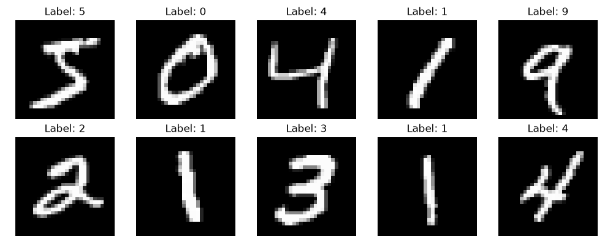

# MNIST Neural Network from Scratch (Python + NumPy)


A two-layer neural network implemented **from scratch** in pure NumPy - no PyTorch, no TensorFlow, no Keras. Trained on the MNIST dataset of handwritten digits, achieving **97.66% test accuracy**.

Includes an interactive drawing app (Pygame) where you can draw a digit with your mouse and the network predicts it in real time.

## Motivation

Built to understand what happens **inside** a neural network: forward pass, backpropagation, gradient descent, and softmax cross-entropy - implemented manually, line by line.

## Architecture

```
Input (784)  →  Hidden (128, ReLU)  →  Output (10, Softmax)
```

- **Input:** 28×28 pixel image flattened to 784 values, normalized to [0, 1]
- **Hidden layer:** 128 neurons, ReLU activation, He initialization
- **Output layer:** 10 neurons (one per digit), Softmax activation
- **Loss:** Categorical cross-entropy
- **Optimizer:** Mini-batch gradient descent (batch size 64, learning rate 0.1)

## Results

| Metric | Value |
|---|---|
| Test accuracy | **97.66%** |
| Train accuracy | 98.75% |
| Training time | ~3 seconds (10 epochs, CPU) |

Loss and accuracy during training:

```
Epoch  1/10 | loss=0.3724 | test_accuracy=93.11%
Epoch  2/10 | loss=0.1990 | test_accuracy=95.08%
Epoch  3/10 | loss=0.1495 | test_accuracy=95.99%
Epoch  4/10 | loss=0.1209 | test_accuracy=96.71%
Epoch  5/10 | loss=0.1016 | test_accuracy=96.73%
Epoch  6/10 | loss=0.0875 | test_accuracy=97.27%
Epoch  7/10 | loss=0.0770 | test_accuracy=97.26%
Epoch  8/10 | loss=0.0684 | test_accuracy=97.54%
Epoch  9/10 | loss=0.0615 | test_accuracy=97.47%
Epoch 10/10 | loss=0.0558 | test_accuracy=97.66%
```

## Sample data



## Interactive demo

The `draw.py` script opens a window where you can draw a digit with your mouse. The trained network predicts it in real time.

```
python3 src/draw.py
```

- **Draw:** hold the left mouse button
- **C:** clear canvas
- **Q:** quit

## Project structure

```
.
├── src/
│   ├── network.py        # NeuralNetwork class (forward, backward, predict)
│   ├── train.py          # Training loop on MNIST
│   ├── load_mnist.py     # Read raw MNIST binary files
│   ├── prepare.py        # Normalize, flatten, one-hot encode
│   ├── visualize.py      # Plot sample digits
│   ├── test_network.py   # Quick sanity check of tensor shapes
│   └── draw.py           # Interactive drawing demo (Pygame)
├── data/
│   └── model_weights.npz # Trained weights (loaded by draw.py)
├── sample_digits.png     # Sample of the training data
├── LICENSE
└── README.md
```

## How to run

### 1. Setup

```bash
python3 -m venv .venv
source .venv/bin/activate
pip install numpy matplotlib pygame-ce
```

### 2. Download MNIST

Download the four files from [Yann LeCun's site](http://yann.lecun.com/exdb/mnist/) and place them in `data/`:

- `train-images-idx3-ubyte`
- `train-labels-idx1-ubyte`
- `t10k-images-idx3-ubyte`
- `t10k-labels-idx1-ubyte`

### 3. Prepare data

```bash
python3 src/prepare.py
```

### 4. Train

```bash
python3 src/train.py
```

This saves trained weights to `data/model_weights.npz`.

### 5. Try the drawing demo

```bash
python3 src/draw.py
```

## Implementation details

### Forward pass

```
z1 = X @ W1 + b1
a1 = ReLU(z1)
z2 = a1 @ W2 + b2
probs = Softmax(z2)
```

### Backward pass (backpropagation)

```
dZ2 = probs - Y
dW2 = a1.T @ dZ2 / batch_size
db2 = sum(dZ2, axis=0) / batch_size
dA1 = dZ2 @ W2.T
dZ1 = dA1 * (z1 > 0)
dW1 = X.T @ dZ1 / batch_size
db1 = sum(dZ1, axis=0) / batch_size
```

### Gradient descent update

```
W1 -= learning_rate * dW1
b1 -= learning_rate * db1
W2 -= learning_rate * dW2
b2 -= learning_rate * db2
```

## Known limitations

The network was trained on centered MNIST digits, where each digit occupies 
roughly the central 20×20 region of a 28×28 image. As a result, the model 
works best when the input digit is drawn centered in the canvas.

Digits drawn very close to the edges may be misclassified. This is a classic 
example of **distribution shift** — the input distribution at inference time 
differs from the training distribution.

## Future work

- **Input preprocessing:** automatically crop and center the drawn digit 
  before feeding it to the network (standard MNIST-style normalization).
- **Data augmentation:** during training, randomly shift each MNIST digit 
  by ±2–4 pixels to make the network robust to translation.
- **Convolutional architecture:** replace the fully-connected layers with 
  a small CNN to better exploit spatial structure.

## Tech

- Python 3.14
- NumPy (all matrix operations)
- Matplotlib (visualization)
- Pygame-ce (interactive demo)

## License

MIT - see [LICENSE](LICENSE).